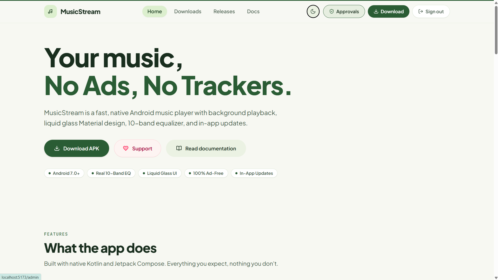

# Zuno — website

Marketing site, documentation, gated downloads, and the update endpoint for the
Zuno Android app.

<p align="center">
  
</p>

**Stack:** React 19 + Vite · React Router · Tailwind CSS v4 · HeroUI v3 ·
Framer Motion · Supabase (auth + database) · deployed on Vercel.

```
api/latest.js           serverless endpoint the Android app polls
api/notify-decision.js  emails the user when they're approved or rejected
src/pages/              Home, Docs, License, Changelog, Login, Signup,
                        Download, Admin, NotFound
src/components/         Nav, Footer, Reveal (animations), ProtectedRoute
src/context/            AuthContext (Supabase session)
src/lib/supabase.js     client + release queries
src/index.css           Tailwind v4 @theme tokens + HeroUI theme overrides
supabase/schema.sql     run this once in Supabase
```

### Styling

Tailwind is **v4**, so there is no `tailwind.config.js` and no
`postcss.config.js` — Tailwind runs as a Vite plugin (`@tailwindcss/vite`) and
the whole theme lives in `@theme` at the top of `src/index.css`.

HeroUI v3 needs **no provider**; importing `@heroui/styles` is enough, and the
import order in `index.css` matters (Tailwind first, HeroUI second). HeroUI's
semantic variables (`--accent`, `--surface`, `--field-*`, …) are repointed at
the brand palette in that same file, so components inherit the coral theme
without per-component overrides.

Two gotchas worth knowing before editing components:

- HeroUI's `Button` is a react-aria button with **no `as` prop**. For routed
  links use react-router's `Link` with `buttonVariants({ variant, size })`,
  which also keeps a real `<a>` for middle-click.
- `TextField`'s `onChange` receives the **value string**, not an event.

---

## 1. Set up Supabase

1. Create a project at [supabase.com](https://supabase.com).
2. **SQL Editor → New query** → paste all of `supabase/schema.sql` → **Run**.
   This creates the `allowed_users` allowlist, the `releases` table, RLS
   policies, and the trigger that blocks non-approved sign-ups.
3. **Authentication → Providers → Email** → enable it.
   For a smoother invite-only flow you can turn *Confirm email* off.
4. **Project Settings → API** → copy the **Project URL** and the **anon public** key.

> Supabase holds only auth and release **metadata**. The APK binaries live on
> Cloudflare R2 — see the next section.

### Adding people to the allowlist

Only emails in `allowed_users` can register. Add them in
**Table Editor → allowed_users**, or with SQL:

```sql
insert into public.allowed_users (email, note)
values ('friend@example.com', 'Beta tester');
```

Anyone else who tries to sign up gets a clear "not on the access list" message.

---

## 2. Set up Cloudflare R2 (APK hosting)

APKs are hosted on R2 rather than Supabase Storage or Vercel, because R2 charges
**no egress fees** — unlimited downloads cost nothing — and allows objects up to
5 TiB. (Cloudflare **Pages** caps assets at 25 MiB, so it cannot host an APK.)

**Current setup:** bucket `musicstream` (Asia-Pacific), served over R2's free


### Publishing an APK

1. Cloudflare dashboard → **R2** → bucket `musicstream` → **Objects** → **Upload**.
2. Name the file `MusicStream-v<versionName>-<versionCode>.apk`, e.g.
   `MusicStream-v2.1.3-20103.apk`. **R2 object names are case-sensitive** — the
   URL must match the filename exactly. **Never overwrite an object that's
   already published**; a URL is referenced by a `releases` row and old links
   must keep working.
3. The public URL is the bucket URL + `/` + the filename. That string goes
   straight into `releases.apk_url`.

Nothing in the code knows about R2 — `apk_url` is just text.

### About the r2.dev URL

Cloudflare marks this URL as *rate-limited and not recommended for production*,
with edge caching unavailable. For an invite-only app with a small group of
testers this is fine — realistic traffic is a handful of downloads per release,
nowhere near a throttling threshold. Egress is free either way.

If you later outgrow it, there are two upgrades, in order of effort:

| Option | Cost | Fixes |
|---|---|---|
| Connect a **custom domain** under R2 → Custom Domains | ~$5–12/yr for a domain | Rate limit + adds edge caching |
| Put a small **Cloudflare Worker** in front of the bucket on `*.workers.dev` | Free (100k req/day) | Rate limit + caching, no domain needed |

Migrating is a one-line change — no code, no redeploy:

```sql
update public.releases set apk_url = 'https://new-host/musicstream-2.1.3-20103.apk'
where version_code = 20103;
```

---

## 3. Run locally

```bash
npm install
cp .env.example .env.local   # then fill in your Supabase URL + anon key
npm run dev
```

> `npm run dev` does **not** serve `api/latest.js` — that's a Vercel serverless
> function. Use `vercel dev` if you need to test the endpoint locally.

---

## 4. Deploy to Vercel

1. Push this folder to its own Git repo.
2. [vercel.com](https://vercel.com) → **Add New → Project** → import the repo.
   Vercel auto-detects Vite; leave the build settings alone.
3. **Settings → Environment Variables** (Production + Preview).

   Required — the site will not work without these:

   | Name | Value |
   |------|-------|
   | `VITE_SUPABASE_URL` | your project URL |
   | `VITE_SUPABASE_ANON_KEY` | your anon public key |
   | `SUPABASE_URL` | same project URL |
   | `SUPABASE_ANON_KEY` | same anon key |
   | `DEVELOPER_EMAIL` | who may use `/admin` and the notify endpoint — must match `is_admin` / `handle_new_user` in `supabase/schema.sql` |

   The `VITE_*` pair is used by the browser; the plain pair by `/api/*`.
   **Never add the `service_role` key** — it bypasses Row Level Security.

   Optional — approve/reject **notification emails**. Approvals work without
   these; you just won't email the user about the decision. Set **one** block:

   | Option A (SMTP, no domain needed) | Option B (Resend, needs verified domain) |
   |---|---|
   | `SMTP_HOST`, `SMTP_PORT`, `SMTP_USER`, `SMTP_PASS`, `MAIL_FROM` | `RESEND_API_KEY`, `MAIL_FROM` |

   See `.env.example` for provider-specific notes — it explains why Resend needs
   a domain and SMTP doesn't. `SMTP_PASS` is a real secret: it lives only in
   Vercel and in your gitignored `.env`, never in the repo.
4. Deploy, then note your **actual** domain — currently
   `https://music-stream-web.vercel.app`. Vercel derives it from the project
   name, so it is not necessarily the name you expect.
5. Put that domain in **`BASE_URL`** in the Android app's
   `update/UpdateManager.kt` and rebuild the APK.

   > **Verify it before shipping:**
   > ```bash
   > curl -sI https://music-stream-web.vercel.app/api/latest   # must be 200
   > ```
   > A wrong host here is unusually costly. Update checks fail silently, and the
   > bad URL is compiled into every APK — so you cannot ship a fix to the users
   > who already have it, because the updater is the thing that's broken. An
   > unclaimed `*.vercel.app` subdomain is also registrable by anyone, and
   > whoever holds it controls the `apkUrl` this app downloads and installs.

---

## 5. Publishing a new version

1. In the Android project, bump **both** `appVersionName` and `appVersionCode`
   in `app/build.gradle.kts`, then `./gradlew clean assembleRelease`.
2. Verify it's signed with the same key as last time:
   ```
   apksigner verify --print-certs app-release.apk
   ```
3. Get the size and hash:
   ```powershell
   (Get-Item .\app-release.apk).Length
   (Get-FileHash .\app-release.apk -Algorithm SHA256).Hash.ToLower()
   ```
4. Upload the APK to the **R2** bucket `musicstream` as
   `MusicStream-v<versionName>-<versionCode>.apk`.
   Never overwrite an already-published object — always use a new filename.
   Confirm it's live and get the exact byte size:
   ```bash
   curl -sI https://pub-cec11ad.r2.dev/MusicStream-v2.1.4-20104.apk
   ```
   Use the `Content-Length` value for `apk_size` — a mismatch makes every
   update fail with "Size mismatch".
5. Insert the row — this single step publishes the release everywhere:
   ```sql
   insert into public.releases
     (version_code, version_name, name, notes, apk_url, apk_size, sha256)
   values (
     20104, '2.1.4', 'MusicStream 2.1.4',
     -- Dollar-quoted: real line breaks, no escaping. One "- item" per line.
     $notes$- Fixed queue reordering
   - Faster artwork loading$notes$,
     'https://pub-cec11addff5f4d68a3cc6df91976c697.r2.dev/MusicStream-v2.1.4-20104.apk',
     48512000,
     '<sha256>'
   );
   ```

That one insert simultaneously:
- adds the entry to the **changelog page**,
- updates the **download page** to the new build,
- and makes **installed apps** show "Update available" on next launch.

To stage a release without announcing it, set `published = false` and flip it to
`true` when you're ready.

---

## How the app finds updates

The app polls `GET /api/latest`, which returns the newest published release:

```json
{
  "schema": 1,
  "versionCode": 20104,
  "versionName": "2.1.4",
  "name": "MusicStream 2.1.4",
  "notes": "- Fixed queue reordering",
  "apkUrl": "https://…/musicstream-2.1.4-20104.apk",
  "apkSize": 48512000,
  "sha256": "…",
  "minSdk": 24,
  "releasePage": "https://…/changelog",
  "mandatory": false
}
```

`versionCode` is the only value that decides whether an update is offered — it
must always increase. The field names are a contract with `UpdateManager.kt`;
renaming one breaks the updater.

The response is sent with `Cache-Control: no-store` so a new release is picked up
immediately rather than after a CDN cache expires.

---

## A note on the download gate

Signing in is required to reach the download **page**, but the APK **URL itself
is public**. It has to be: the Android app has no login session, so it must be
able to fetch updates unauthenticated.

Treat the gate as access control for the site, not as a guarantee that the APK
can't be shared. Anyone who copies a URL out of the page or the manifest can
download it directly.

---

## Licence

**Proprietary — not open source.** See [`LICENSE`](LICENSE).

MusicStream is provided free of charge to approved individuals for personal,
non-commercial use. Redistribution, resale, and commercial use are not
permitted. Publishing this repo publicly does **not** make it reusable by
others; the licence text is the authority, and the `/license` page on the site
mirrors it.

MusicStream hosts no music. It is a client for publicly accessible data from an
unofficial API; all music, artwork, and metadata belong to their respective
rights holders.
